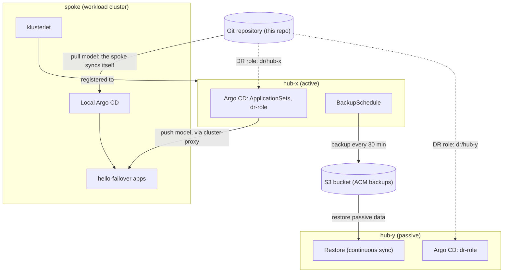

# ACM & OpenShift GitOps hub failover

A working reference for surviving the loss of a Red Hat Advanced Cluster
Management (ACM) hub when workloads are delivered by OpenShift GitOps
(Argo CD). Two hubs run active/passive, replicating hub state through
ACM backup and restore on a shared S3 bucket; workloads come from git.
The repo carries the manifests to build it, runbooks to fail over, and
the measured results of running every procedure live on ACM 2.17.

It covers the full matrix of how workloads are **delivered** (each
cluster pulls from git, or the hub's Argo CD pushes) and how a failover
is **operated** (an operator with a runbook, or a pull request whose
review is the split-brain gate).

## Architecture



When hub-x dies, the workloads keep running. Failover activates hub-y's
restore: it claims the spoke (ManagedServiceAccount auto-import re-points
the klusterlet), takes over backups, and resumes push delivery. The pull
app never stops deploying, because the spoke syncs from git on its own.
The two hubs never talk to each other; the bucket is their only shared
state. Why it is built this way, and why there is deliberately no fully
automatic failover, is in [docs/design.md](docs/design.md).

## The four paths

| Delivery | Operation | Runbook | Result |
| --- | --- | --- | --- |
| Pull | Manual | [dr-failover-pull-manual](docs/runbooks/dr-failover-pull-manual/README.md) | Spoke re-homed 10–39 s after activation; deploys land with no hub alive; zero downtime |
| Pull | Git-driven (PR) | [dr-failover-pull-gitops](docs/runbooks/dr-failover-pull-gitops/README.md) | Two-PR choreography (the one-PR flip was falsified live); merge to claim 20–72 s; zero downtime |
| Push | Manual | [dr-failover-push-manual](docs/runbooks/dr-failover-push-manual/README.md) | Push delivery down until the new hub pushes: RTO 2:53–4:59; the app kept serving throughout |
| Push | Git-driven (PR) | [dr-failover-push-gitops](docs/runbooks/dr-failover-push-gitops/README.md) | Push RTO 2:45–4:11, faster than the manual push run on the same day; the PR history is the audit log |

Start with the Manual Pull Path: the other three runbooks are written as
deltas against it. Timings, conditions and the findings behind each
runbook step are in [docs/results.md](docs/results.md).

## Getting started

You need three OpenShift clusters (two that can run ACM 2.17 as hubs, and
one workload cluster; this repo was verified on OpenShift 4.21, so check
the ACM support matrix for other versions), an S3-compatible bucket both
hubs can reach, a git repository every cluster can reach, and a
Linux workstation (WSL works; the scripts use GNU `date` and `sed`) with
bash 4 or newer, `oc`, `git`, `jq` and curl 8 or newer.
Two tools are optional for the `hack/` scripts:
[gum](https://github.com/charmbracelet/gum) gives them menus, a pinned
progress header and boxes (without it, or with `DR_PLAIN=1`, they print
plain text), and `gh`, signed in, lets `hack/dr.sh` open the git-driven
failover's pull requests itself (without it, it prints a link to
GitHub's new-PR page, filled in).

1. **Fork or copy this repo** and change the values below to match your
   environment. To exercise a copy without touching its `main`, put the
   changed values on a branch and set `targetRevision` to that branch:
   the git-driven failover pull requests and the mid-outage deploys then
   land on the branch too. The `hack/` scripts push to that branch
   directly (the mid-outage deploy, the teardown's reset of `dr/`), so it
   must accept pushes from your workstation: with a protected `main`,
   use a branch.
2. **Build the environment**: [docs/build.md](docs/build.md) applies
   `manifests/` step by step and bootstraps `dr/`. `hack/build.sh` runs
   the same steps for you ([the scripted
   build](docs/build.md#the-scripted-build)); its menu offers Check and
   Build. Start with Check (`hack/build.sh --check`), which changes
   nothing on the clusters. Its first stage asks which clusters, branch
   and bucket to use and saves them in `~/acm-dr/`; after that, it shows
   them, to keep or change.
3. **Run a failover** with one of the runbooks above, by hand or with
   `hack/dr.sh`: its menu offers Check (the pre-flight), Run (Manual)
   and Run (Git), and a run opens with a page on what it will do, stage
   by stage, and what it needs from you.
4. **Tear it down** with `hack/teardown.sh`
   ([Tearing it down](docs/build.md#tearing-it-down)). Its menu offers a
   dry run (Check) and the teardown itself, in two modes: Reset removes
   only the exercise (the DR roles, the demo apps, and `dr/` in git back
   to the roles the next build starts from) and keeps ACM, OpenShift
   GitOps and the backup storage, so the next build takes minutes; Full
   also removes ACM and OpenShift GitOps, whoever installed them, and
   detaches the workload cluster. As a command without `--reset` or
   `--full`, it removes only what this repo put on the clusters.

With no options on a terminal, each `hack/` script opens on its menu and
comes back to it after every pick, done or stopped; only Quit (or
Ctrl-C) leaves. With options, it runs once and exits, for scripting.

| Value | Where it is set | Default here |
| --- | --- | --- |
| Git repository URL | `repoURL` in `manifests/62-appset-pull.yaml`, `manifests/63-appset-push.yaml`, `dr/bootstrap/dr-role-hub-*.yaml` (CI fails if they disagree; the `hack/build.sh` pre-flight checks they name your clone's `origin`) | `https://github.com/redhat-na-ssa/acm-failover-demo` |
| Git revision the clusters track | `targetRevision` in the same four files | `main` |
| S3 endpoint, bucket, prefix, region | `manifests/50-dpa.yaml` (a copy, per build step 3), or the Settings stage of `hack/build.sh`, which saves them in `~/acm-dr/dr.env` | `https://s3.example.com`, `acm-backups`, `acm`, `us-east-1` |
| Workload cluster name | `manifests/40-import-spoke.yaml` and the `name: spoke` selector in `manifests/61-gitops-integration.yaml` | `spoke` |
| Hub names | `dr/hub-x/`, `dr/hub-y/` and `dr/bootstrap/dr-role-hub-{x,y}.yaml` (directory name and `path` must match) | `hub-x`, `hub-y` |
| kubeconfig contexts | the `export` lines at the top of each runbook; for the `hack/` scripts, the Settings stage of `hack/build.sh` copies your kubeconfig to `~/acm-dr/kubeconfig` with the three contexts renamed | `hub-x`, `hub-y`, `spoke` |
| Hub replica mode | `availabilityConfig` in `manifests/20-multiclusterhub.yaml` | `Basic` (single-node hubs) |

## Repository layout

```
manifests/   every CR the build applies, numbered by component (docs/build.md)
apps/        the demo apps: hello-failover (pull) and hello-failover-push (push)
dr/          git-driven DR roles: one overlay per hub, the active/passive
             roles, the activation template, and the per-hub bootstrap
docs/        design, build, results, runbooks
hack/        build.sh builds the environment, dr.sh runs a whole DR
             exercise (see the runbooks), teardown.sh removes it again;
             lib/ holds what they share; and the validation scripts used
             locally and by CI
```

## Validation

`hack/validate.sh` checks everything that can be checked without
clusters, and runs on every pull request
([.github/workflows/validate.yaml](.github/workflows/validate.yaml)):

- yamllint, shellcheck of the scripts in `hack/`, and `kustomize build`
  of every `dr/` overlay and role;
- strict schema validation of every manifest against the upstream CRDs
  for ACM 2.17, OADP, Argo CD, OLM and OpenShift routes, so a misspelled
  field fails;
- the repo's own invariants: the manual (`manifests/`) and git-driven
  (`dr/`) copies of each DR object are identical, both `dr-role`
  Applications keep their backup-exclusion label, each hub overlay
  renders a legal role, every Argo source names the same repo, and every
  object carries the `app.kubernetes.io/part-of: acm-gitops-failover`
  label the teardown goes by;
- relative links in the docs resolve, and so does every doc section the
  `hack/` scripts link to; every Mermaid diagram renders.

It needs python3 with PyYAML, yamllint, shellcheck, kubeconform, kustomize (or
kubectl) and, for the diagram check, `mmdc` from
`@mermaid-js/mermaid-cli`. Live behavior can only be proven on clusters:
that is what the runbooks' exercises and [docs/results.md](docs/results.md)
are for.

## Documents

| Document | What it holds |
| --- | --- |
| [docs/design.md](docs/design.md) | The two-layer design, the delivery models, the four-path comparison, sources |
| [docs/build.md](docs/build.md) | Prerequisites, versions, the build in apply order and scripted, build-time gotchas, the teardown |
| [docs/runbooks/](docs/runbooks/) | The four operator runbooks: command, rationale, success and failure for every step |
| [dr/README.md](dr/README.md) | How the git-driven DR roles work, and why failover takes two pull requests |
| [docs/results.md](docs/results.md) | Measured results and the findings behind the runbook steps |
| [docs/msa-token-hygiene.md](docs/msa-token-hygiene.md) | Why every activation needs the MSA token cleanup |
