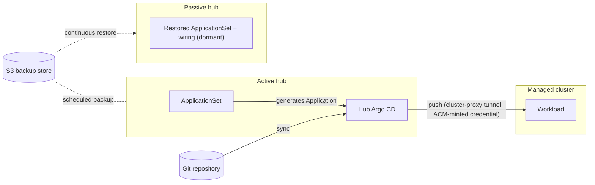
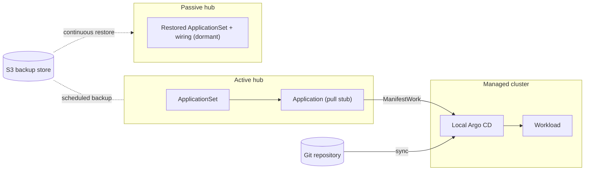

# Failover design

Why the architecture looks the way it does: two independent layers, so
that losing the management hub costs neither workloads nor — with the
right delivery choice — deployments. The environment it was proven on
is described in [build.md](build.md); the live proof is in
[results.md](results.md).

## Delivery models

The two workload delivery models the matrix exercises:

### Push model

The hub's Argo CD syncs from git and pushes manifests to each managed
cluster over an ACM-minted credential. New deploys stop when the hub
dies and resume once the new active hub's Argo pushes again.

### Pull model

The hub only distributes the Application definition; each managed
cluster's local Argo CD syncs from git itself. Delivery does not depend
on a live hub — running workloads and new deploys both survive hub loss.

## Two layers

The design follows the pattern the public sources converge on — two layers:

- **Hub state: active/passive backup-restore.** This is Red Hat's
  productized hub-DR architecture: one primary, N passive hubs continuously
  restoring from shared S3-compatible storage, deliberate manual failover.
  Documented in the ACM Business Continuity guide (["Configuring
  active-passive hub
  cluster"](https://docs.redhat.com/en/documentation/red_hat_advanced_cluster_management_for_kubernetes/2.17/html-single/business_continuity/index#active-passive-config),
  ["Disaster
  recovery"](https://docs.redhat.com/en/documentation/red_hat_advanced_cluster_management_for_kubernetes/2.17/html-single/business_continuity/index#disaster-recovery))
  and the [RHACM high availability and disaster recovery blog series
  (part 1)](https://www.redhat.com/en/blog/rhacm-high-availability-and-disaster-recovery-part-1)
  ([part 2](https://www.redhat.com/en/blog/rhacm-high-availability-and-disaster-recovery-part-2),
  [part 3](https://www.redhat.com/en/blog/rhacm-high-availability-and-disaster-recovery-part-3),
  and the [backup-and-restore hub clusters
  blog](https://www.redhat.com/en/blog/backup-and-restore-hub-clusters-with-red-hat-advanced-cluster-management-for-kubernetes)).
  Because the managed clusters here are *imported* (not Hive-created),
  [**ManagedServiceAccount auto-import** is effectively
  mandatory](https://docs.redhat.com/en/documentation/red_hat_advanced_cluster_management_for_kubernetes/2.17/html-single/business_continuity/index#restore-imported-managed-clusters)
  (`useManagedServiceAccount: true`) — [without it every failover ends in
  `Pending Import`](https://docs.redhat.com/en/documentation/red_hat_advanced_cluster_management_for_kubernetes/2.17/html-single/business_continuity/index#auto-connect-clusters-msa).
- **Workloads: git as source of truth, pull-model GitOps.** Even Red Hat's
  [pull-model announcement
  blog](https://www.redhat.com/en/blog/introducing-the-argo-cd-application-pull-controller-for-red-hat-advanced-cluster-management)
  concedes "the hub cluster itself still represents a potential single
  point of failure" — so workloads must not depend on any hub. With the
  [pull-model
  architecture](https://docs.redhat.com/en/documentation/red_hat_advanced_cluster_management_for_kubernetes/2.17/html-single/gitops/index#arch-pull),
  each managed cluster's local Argo CD syncs from git independently; hub
  loss stops only propagation of *new* ApplicationSet decisions and status
  aggregation. Argo CD itself [never prunes without explicit
  `prune: true`](https://argo-cd.readthedocs.io/en/stable/user-guide/auto_sync/),
  and [its state is rebuildable from
  git](https://argo-cd.readthedocs.io/en/stable/operator-manual/disaster_recovery/).
- The two layers composed are exactly Red Hat's November 2025 reference:
  [Argo CD Disaster Recovery strategy using RHACM and
  OADP](https://www.redhat.com/en/blog/argo-cd-disaster-recovery-strategy-using-red-hat-advanced-cluster-management-and-oadp).

The load-bearing argument for the second layer is an observed fact:
anything delivered by hub addons dies with the hub relationship, while
GitOps-delivered state is cluster-local and survives. Hub backup/restore
protects only the hub's *own* state (cluster inventory, policies,
placements, the GitOps wiring itself).

## The four paths

The repo carries the full 2×2 of delivery model × DR operation — all
four cells verified live ([results](results.md); the summary
table is in the [README](../README.md)). How
the halves differ, in one line each:

- **Pull vs push** is *what a hub outage costs delivery*: nothing (spoke
  syncs git itself — every mid-outage deploy in every exercise landed hubless) vs a
  delivery outage lasting until the new hub's Argo resumes pushing
  (the Manual Push Path measures it). It is also *what the hub is worth to an
  attacker*: push runs on an ACM-minted credential whose managed-cluster
  SA is cluster-admin-equivalent (verified — Manual Push Path runbook P.2), so a
  compromised hub Argo is admin on every cluster it pushes to; pull
  keeps the hub credential-free for delivery and the app's RBAC
  namespace-scoped.
- **Manual vs git-driven** is *what a failover decision looks like*: an
  operator with a runbook (≈10 s of machinery after seconds of typing)
  vs a pull request whose review is the split-brain gate and whose merge
  history is the audit log (measured cost: tens of seconds of merge and
  Argo sync on top of the same machinery).

Why there is no fully autonomous path: hub failover is
deliberately a human decision. A passive-side monitor cannot distinguish
"active hub died" from "network partition," and with MSA auto-import an
activation actively re-points the fleet's klusterlets — automating a
false positive moves the fleet onto a second live hub. `BackupCollision`
guards the bucket, not cluster claims; going autonomous safely requires a
quorum witness/fencing, and the architecture has already made hub
downtime cheap (workloads run and — on pull — deploy hubless). Automate
the detection, the pre-flight, and the execution; keep the decision
human. The automated paths' PR gate is exactly that boundary drawn in git.

Delivery infrastructure shared by the push paths:
[manifests/63-appset-push.yaml](../manifests/63-appset-push.yaml) +
[apps/hello-failover-push/](../apps/hello-failover-push/) (separate
namespace — both models coexist through one outage). Role-flip
infrastructure for the automated paths: [dr/](../dr/README.md).

## Know before you adapt it

Documented behavior that this repo relies on or deliberately avoids, worth
checking before changing the design:

- **What the hub backup carries.** [All `*.open-cluster-management.io`
  resources plus the `argoproj.io` API group](https://docs.redhat.com/en/documentation/red_hat_advanced_cluster_management_for_kubernetes/2.17/html-single/business_continuity/index#backed-up-resources),
  so hub-side Applications and ApplicationSets fail over with the hub.
  Excluded: everything in the MultiClusterHub namespace, ManifestWorks
  (`work.open-cluster-management.io`; the restored owners regenerate
  them), and the BackupSchedule and Restore objects themselves.
- **Argo CD repository credentials are not in the default backup
  scope.** This repo is public, so nothing is needed. With a private repo,
  label its repository Secret `cluster.open-cluster-management.io/backup`
  so it is restored too, as [Red Hat's Argo CD DR
  reference](https://www.redhat.com/en/blog/argo-cd-disaster-recovery-strategy-using-red-hat-advanced-cluster-management-and-oadp)
  does, or recreate it on the new hub before failover.
- **Pull-model Applications live on the spoke as ManifestWork output.**
  After the spoke re-homes, its work agent evicts work that the new hub
  does not recreate, after a grace period that defaults to [60 minutes
  upstream](https://github.com/open-cluster-management-io/ocm/blob/main/pkg/work/spoke/options.go).
  In the timed run the new hub regenerated the app's ManifestWork about a
  minute after activation; a new hub that cannot do that within the hour
  takes the pull-model Application away.
- **Both hubs must be configured identically**: [same ACM version, same
  operators in the same namespaces](https://docs.redhat.com/en/documentation/red_hat_advanced_cluster_management_for_kubernetes/2.17/html-single/business_continuity/index#prepare-new-hub), and the same
  bucket. A backup cannot be restored onto an older ACM version.
- **Do not enable the GitOps addon on the GitOpsCluster** if you want
  push delivery: [enabling it disables the push model for all
  applications](https://docs.redhat.com/en/documentation/red_hat_advanced_cluster_management_for_kubernetes/2.17/html-single/gitops/index#manage-gitops-addon).
- **Velero skips resources that already exist on restore**, which is why
  the docs [prefer a clean restore hub](https://docs.redhat.com/en/documentation/red_hat_advanced_cluster_management_for_kubernetes/2.17/html-single/business_continuity/index#prepare-new-hub). The role
  swap used here works because a returned hub's leftover GitOps wiring is
  byte-identical to the backup (both come from the same git commits);
  audit leftovers on a hub that drifted.
- **Testing without killing the active hub** has its own documented
  procedure ([pause the schedule and mark ManagedClusters
  `disable-auto-import`](https://docs.redhat.com/en/documentation/red_hat_advanced_cluster_management_for_kubernetes/2.17/html-single/business_continuity/index#keep-hub-active-restore-prepare)). The
  runbooks here kill the hub instead, because that is the case the design
  exists for.

## Sources

Primary documentation (ACM 2.17; every claim above links to its exact
section):

- [Business continuity (backup/restore, active-passive, disaster recovery)](https://docs.redhat.com/en/documentation/red_hat_advanced_cluster_management_for_kubernetes/2.17/html-single/business_continuity/index)
- [Clusters (import, detach, cleanup procedures)](https://docs.redhat.com/en/documentation/red_hat_advanced_cluster_management_for_kubernetes/2.17/html-single/clusters/index)
- [GitOps (GitOpsCluster, push/pull models, gitops addon)](https://docs.redhat.com/en/documentation/red_hat_advanced_cluster_management_for_kubernetes/2.17/html-single/gitops/index)
- [Get started (install, MultiClusterHub advanced configuration, sizing, uninstall)](https://docs.redhat.com/en/documentation/red_hat_advanced_cluster_management_for_kubernetes/2.17/html-single/get_started/index)
- [Argo CD: automated sync/prune/self-heal](https://argo-cd.readthedocs.io/en/stable/user-guide/auto_sync/), [cluster bootstrapping (app-of-apps)](https://argo-cd.readthedocs.io/en/stable/operator-manual/cluster-bootstrapping/), [declarative cluster secrets](https://argo-cd.readthedocs.io/en/stable/operator-manual/declarative-setup/#clusters), [disaster recovery](https://argo-cd.readthedocs.io/en/stable/operator-manual/disaster_recovery/)

Red Hat blogs (architecture endorsements):

- [RHACM: High availability and disaster recovery — part 1](https://www.redhat.com/en/blog/rhacm-high-availability-and-disaster-recovery-part-1), [part 2](https://www.redhat.com/en/blog/rhacm-high-availability-and-disaster-recovery-part-2), [part 3](https://www.redhat.com/en/blog/rhacm-high-availability-and-disaster-recovery-part-3)
- [Backup and Restore Hub Clusters with RHACM](https://www.redhat.com/en/blog/backup-and-restore-hub-clusters-with-red-hat-advanced-cluster-management-for-kubernetes)
- [Argo CD Disaster Recovery strategy using RHACM and OADP](https://www.redhat.com/en/blog/argo-cd-disaster-recovery-strategy-using-red-hat-advanced-cluster-management-and-oadp) — the composed two-layer architecture this guide implements
- [Introducing the Argo CD Application Pull Controller for RHACM](https://www.redhat.com/en/blog/introducing-the-argo-cd-application-pull-controller-for-red-hat-advanced-cluster-management)
- [Using the Argo CD Agent with OpenShift GitOps](https://developers.redhat.com/blog/2025/10/06/using-argo-cd-agent-openshift-gitops) — the Tech Preview evolution of the pull model
- [stolostron/cluster-backup-operator](https://github.com/stolostron/cluster-backup-operator)
