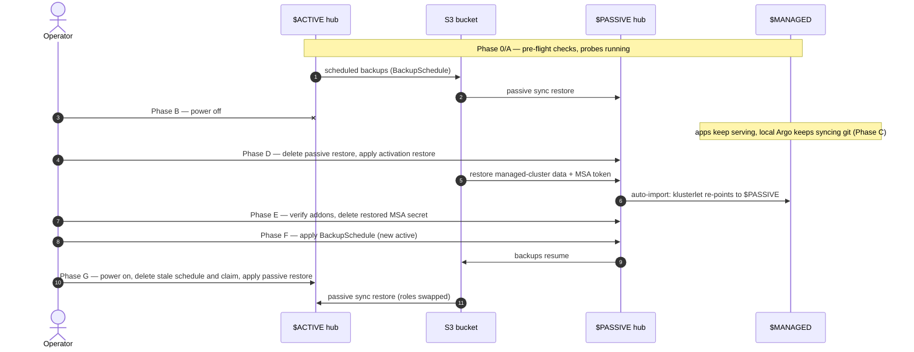

# DR failover exercise runbook — command / rationale / success / failure

Operator-facing script for the full active/passive hub failover exercise:
pre-flight, disaster, activation, verification, new-primary duties, and
failback-as-role-swap. Every step gives the command, why it exists, what
success looks like, and the failure modes with recovery. Measured
timings from the live runs are in [results.md](../../results.md).

**This is the Manual Pull Path** (manual operation, pull delivery — see [the four paths](../../../README.md#the-four-paths)).
Siblings: the [Automated Pull Path](../dr-failover-pull-gitops/README.md) git-driven operation,
the [Manual Push Path](../dr-failover-push-manual/README.md) push delivery,
the [Automated Push Path](../dr-failover-push-gitops/README.md) both — all three are
deltas against this document, so a change here must be checked against
them.

## Running it with `hack/dr.sh`

[`hack/dr.sh`](../../../hack/dr.sh) runs this runbook and its three
siblings, one command per exercise. It runs the commands below in
order, enforces every **Gate**, and labels its output with this
document's step numbers, so this document stays the explanation of what
it does. It never powers a cluster off or on: it tells you when to cut
or restore power, then waits until the API is dead or answers again.

It reads the settings file `~/acm-dr/dr.env`, which
[`hack/build.sh`](../../build.md#the-scripted-build) writes, so a lab
the build made is ready. For a lab built by hand, write it once, in the
repo checkout on the branch the clusters track:

```bash
mkdir -p ~/acm-dr && cp hack/dr.env.example ~/acm-dr/dr.env
${EDITOR:-vi} ~/acm-dr/dr.env   # KUBECONFIG, ACTIVE, PASSIVE, the two app URLs, BRANCH
```

Then:

```bash
sudo dnf install -y gum         # optional (brew install gum elsewhere): boxes, spinners and tables
hack/dr.sh check                # Phase 0, read-only (plus the P.2 check once dr/ is bootstrapped)
```

With [gum](https://github.com/charmbracelet/gum) installed, the script
shows a stage tracker, a spinner with the elapsed time while it waits,
a boxed **YOUR TURN** (with the terminal bell) when it needs you, and a
timing table at the end. Each stage starts on a clear screen, and from
the Deploy stage on, the run waits for you to pick Continue first, so
you can read the last stage (`--yes` skips the waits). The timing table
leaves the time spent at those prompts out of every time it shows, and
says how long it was. During a
run the top of the screen stays put: the stage tracker and the time
since the run started, both probes' samples and
failures, which hub `$MANAGED` reports to and which revisions are
served, and the last milestone. The output scrolls under it. What
scrolls off is gone from the screen but kept in `console.log`; the
summary at the end scrolls as usual, so the scrollback keeps it. The
pinned header needs a terminal of at least 72 columns and 22 lines, and
`DR_PIN=0` turns it off. With gum, a pre-flight section that is all
green, in a run or in `hack/dr.sh check`, collapses to one line: its
heading, a ✓ and what it found. Without gum, or with `DR_PLAIN=1`, the
script prints the same steps as plain text.

Each stage opens with a paragraph on what it is about to do and why, and
each step with a line or two, so a run can be followed (or presented)
without this document open. A RED pre-flight line links to the section
of the docs that explains what could be wrong.

Then one exercise is one command. On its own, `hack/dr.sh` says what the
exercise does and offers a short menu: Check (the lab), Run (Manual),
Run (Git), or Quit. Each pick, done or stopped, ends with Back to the
menu, which shows the menu again with the settings read afresh; only
Quit (or Ctrl-C) leaves. The same choices are also commands, which run
once and exit, and so are the
last run's summary (`hack/dr.sh probe summary`) and approving
certificates after a power-on (`hack/dr.sh nodes`):

```bash
hack/dr.sh              # the menu
hack/dr.sh run          # the manual paths: this runbook and the Manual Push Path
hack/dr.sh run --git    # the git-driven paths: you review and merge each PR it opens
```

`run` opens with a page on what the run will do: each stage in a line
or two, what it needs from you, how the lab ends up, and where the logs
go. Continue starts the pre-flight; Back to the menu changes nothing.
After that, it stops only for what you have to do yourself: cut `$ACTIVE`'s
power (B.1), merge the PRs on a `--git` run (D'.2, F', G'.1), and power
the hub back on (G.0). For each PR it pushes the branch and prints a
link to GitHub's new-PR page with the title and body filled in (with
`gh` signed in, it opens the PR itself). It asks before it starts and
before a manual activation (D.2); `--yes` skips both questions. Both demo apps run side by side, so every
exercise probes and deploys both: one run covers pull and push delivery.
At the end, `rejoin` swaps `ACTIVE` and `PASSIVE` in the settings file
and bumps `RUN`, so the next `run` goes the other way.

Its death gate is B.1's check, hardened. `$PASSIVE` and `$MANAGED` must
answer, and `$ACTIVE`'s API must refuse connections or time out twice,
10 s apart. A name that does not resolve is DNS trouble, not proof of
death, and stops the script.

If a run stops partway, fix the cause, then run the remaining steps:

| Command | Steps |
| --- | --- |
| `hack/dr.sh check` | Phase 0, read-only |
| `hack/dr.sh nodes [context...]` | G.1's power-on note: approve pending certificate requests until the nodes are Ready (all three clusters by default, for example after powering the whole lab on) |
| `hack/dr.sh probe start` / `stop` / `summary [N]` | Phase A and the Phase H summary; the probes run detached, so closing the terminal does not stop them. `summary N` rebuilds run N's summary from its logs |
| `hack/dr.sh outage` | B.0, B.1, B.2 |
| `hack/dr.sh deploy` | C, for both apps |
| `hack/dr.sh failover [--git]` | the death gate, then D, E, F (or D', E, F') |
| `hack/dr.sh rejoin [--git]` | G and H.1 (or G'.1, G'.2) |

Each run's evidence lands in `~/acm-dr/runs/run-$RUN/`: the probe logs
(`probe.log`, `probe-push.log`, `hub-pointer.log`, and `revisions.log`,
one line each time an app's served revision changes), `events.log` (one
timestamped line per step; the summary's timing table is computed from
it) and `console.log` (everything the script printed, as plain text).
A run started again after a stop carries on in the same folder: its
events say which attempt it is, and "Whole run" counts from the latest
answer to "Start run N?". The availability table splits each app's
samples at B.1, so a failed sample before the power cut is not counted
against the failover. The rows that start at the cut or at C's deploy
include C.1's wait for the pull app, which is bound by `$MANAGED`'s Argo
poll (1 to 6.5 minutes with Argo's defaults: a refresh every 2 minutes
plus up to 1 minute of jitter, a branch resolution cached for up to 3
minutes, then about 1 minute for the ConfigMap volume); the rows that
start at the activation (or at the PR-A merge) do not.

## Conventions

The posture is symmetric — set these once and every command below works in
either direction. Before anything else, write down the mapping from these
generic names to your real kubeconfig contexts: generic names can collide
with real cluster names (a real hub literally named "spoke" has happened),
and a mistyped context in Phase B kills the wrong cluster.
If you work from the kubeconfig copy in
[build.md](../../build.md#clusters), run
`export KUBECONFIG=~/acm-dr/kubeconfig` in every terminal first,
including the probe terminals.

```bash
export ACTIVE=hub-x       # hub about to "die" (hub-x in the repo's starting posture)
export PASSIVE=hub-y      # hub that will activate
export MANAGED=spoke      # workload cluster that re-homes
export APP_URL=https://hello-failover-hello-failover.apps.spoke.example.com   # <apps domain of $MANAGED>
export ACTIVE_API=$(oc --context $ACTIVE whoami --show-server)   # read from kubeconfig while the hub is alive
export RUN=$(date -u +%Y%m%d)-1   # names this run's probe logs: same value in every terminal, bump -1 per run
```

Every terminal you run commands in needs these exports. With
`$ACTIVE` empty, `oc --context $ACTIVE get nodes` reads `get` as the
context name and fails with `flags cannot be placed before plugin
name`. Check a terminal before using it:

```bash
echo "ACTIVE=${ACTIVE:?unset} PASSIVE=${PASSIVE:?unset} MANAGED=${MANAGED:?unset} ACTIVE_API=${ACTIVE_API:?unset} RUN=${RUN:?unset}"
```

The whole exercise at a glance (the hub-pointer flip in Phase D is the
re-home):



- All timestamps UTC (`date -u`) so probe logs and cluster conditions
  correlate.
- Never skip a **Gate** line — each phase's gate is the condition that
  makes the next phase safe.
- Evidence artifacts: `~/probe-$RUN.log` (availability),
  `~/hub-pointer-$RUN.log` (re-home), plus pasted command outputs.
  One log pair per run keeps E.2's flip search honest when you run
  several exercises in a day.
  Any persistent background runner and log location works — the logs
  are the evidence, not the terminals.

## Phase 0 — Pre-flight (read-only except the repair)

### 0.1 Posture sanity

```bash
oc --context $ACTIVE  get backupschedule -n open-cluster-management-backup
oc --context $ACTIVE  get managedclusters
oc --context $PASSIVE get restore -n open-cluster-management-backup
oc --context $PASSIVE get managedclusters
```

**Why:** Confirms the roles are what you think they are before you kill
anything. The activation procedure assumes exactly one active hub (schedule
`Enabled`, owns `$MANAGED`) and one passive hub (restore `Enabled` in sync
mode, owns only `local-cluster`).

**Success:** Active: `schedule-acm Enabled`, recent backups `Completed`,
`local-cluster` + `$MANAGED` both `True/True`. Passive:
`restore-acm-passive-sync Enabled`, `local-cluster` only.

**Failure:** Passive lists `$MANAGED` → you have two hubs claiming one
cluster (split-brain posture); stop and resolve before any exercise.
Restore not `Enabled` → passive sync is dead; fix before proceeding (a
failover with a stale passive restores stale state).

### 0.2 MSA token chain — the load-bearing check

```bash
oc --context $ACTIVE get managedserviceaccount -A \
  -o custom-columns='NS:.metadata.namespace,NAME:.metadata.name,TOKEN-REPORTED:.status.conditions[?(@.type=="TokenReported")].status,EXPIRES:.status.expirationTimestamp'
```

**Why:** With imported clusters, activation reaches `$MANAGED` using the
ManagedServiceAccount token carried in the backup. If that token is
missing, expired, or frozen, failover ends in `Pending Import` — the
single most likely way this whole architecture fails. `TokenReported` must
be checked explicitly: a Velero-restored-but-frozen secret passes the
weaker "does a token exist" checks while rotation is already dead
(see [MSA token hygiene](../../msa-token-hygiene.md)).

**Success:** Every `auto-import-account` row: `TOKEN-REPORTED: True` (`False`
or empty both fail),
expiry comfortably in the future (rotation validity is 144h; expect
several days out).

**Failure:** `False` with `cannot set an ownerRef on a resource you can't
delete` → the restored secret from a previous activation was never cleaned
up. Repair (safe ONLY when the cluster is already imported and
`managed-serviceaccount` addon `Available`):

```bash
oc --context $ACTIVE delete secret auto-import-account -n $MANAGED
sleep 30
oc --context $ACTIVE get managedserviceaccount auto-import-account -n $MANAGED \
  -o jsonpath='{.status.conditions[?(@.type=="TokenReported")].status}{" | "}{.status.expirationTimestamp}{"\n"}'
# expect: True | <now + 144h>
oc --context $ACTIVE get secret auto-import-account -n $MANAGED \
  -o jsonpath='{.metadata.ownerReferences[0].kind}{"\n"}'
# expect: ManagedServiceAccount   (controller-owned; the frozen copy had none)
```

### 0.3 A backup newer than every fix

```bash
oc --context $ACTIVE get backup -n open-cluster-management-backup \
  --sort-by=.status.startTimestamp \
  -o custom-columns='NAME:.metadata.name,PHASE:.status.phase,START:.status.startTimestamp' | tail -6
```

**Why:** Failover restores `latest`. Any repair (0.2 included) is not
DR-protected until a credentials backup taken *after* it reaches
`Completed` — the backup cadence (30 min here) is the repair-to-protection
lag, and the same number that anchors the RPO conversation.

**Success:** An `acm-credentials-schedule-*` set with `START` later than
your newest change, `PHASE: Completed`.

**Failure:** No new set past its cron slot → check
`oc --context $ACTIVE get schedules.velero.io -n open-cluster-management-backup`
(`LAST-BACKUP` distinguishes "hasn't fired yet" from "fired and stalled").
Note: after a cluster cold start the first backup fires off-cadence as a
catch-up, then the cron reasserts — off-slot timestamps right after a
power-on are normal.

### 0.4 Remaining static checks

```bash
oc --context $PASSIVE get ns open-cluster-management-global-set -o name   # must exist
oc --context $PASSIVE get crd routes.route.openshift.io                    # must be NotFound
oc --context $PASSIVE get pods -n openshift-gitops --no-headers | awk '{print $1,$3}'
oc --context $PASSIVE get backupstoragelocation -n open-cluster-management-backup
```

**Why (in order):** (1) the global-set namespace is where the
`managed-serviceaccount`/`cluster-proxy`/`work-manager` addons install
from — missing it silently breaks the whole MSA chain on the new hub;
(2) a stray gitopsaddon Route CRD 503s the aggregated API and wedges Argo
cluster caches at the worst possible moment; (3) the new hub must run the
same GitOps operator so restored wiring lands on a working Argo; (4) the
passive hub must already reach the shared bucket.

**Success:** namespace exists / CRD `NotFound` / all Argo pods `Running` /
BSL `Available`.

**Failure:** resolve before the exercise — all four are cheap now and
expensive mid-outage.

**Gate:** 0.1–0.4 all green → proceed.

## Phase A — Baseline and probes

### A.1 Availability probe (own terminal, runs through the whole exercise)

```bash
while true; do echo "$(date -u +%FT%TZ) $(curl -s -o /dev/null -w '%{http_code}' --max-time 5 $APP_URL)"; sleep 10; done | tee -a ~/probe-$RUN.log
```

**Why:** The architecture's core claim — workloads decoupled from hub
liveness — is only provable by an independent observer running before,
during, and after the disaster. `--max-time 5` forces hung connections to
log as failures instead of masquerading as slow successes.

**Success:** Unbroken `200`s for the entire exercise.

**Failure:** Any non-200 during the exercise is a finding — timestamp it
and correlate (a non-200 *after* the exercise window may just be your lab
powering down; check before writing it up as a DR failure). A lone `000`
is curl giving up after 5 s with no answer. If the other app answered
through the same router in the same seconds, and the app's pod, route and
endpoints did not change, suspect the probe's own side (a slow DNS lookup
or connect from the workstation) before the cluster. `hack/dr.sh` writes
curl's exit code and timings (in seconds) on every sample that is not
`200`: exit 28 is the timeout, and a `dns=` near 5 means the lookup was
what stalled.

### A.2 Hub-pointer probe (second terminal)

```bash
while true; do echo "$(date -u +%FT%TZ) $(oc --context $MANAGED get secret bootstrap-hub-kubeconfig -n open-cluster-management-agent -o jsonpath='{.data.kubeconfig}' --request-timeout=5s 2>/dev/null | base64 -d | awk '/server:/{print $2}')"; sleep 10; done | tee -a ~/hub-pointer-$RUN.log
```

**Why:** Timestamps the exact second `$MANAGED`'s klusterlet re-points
from the dead hub to the new one — the managed-cluster half of your RTO,
measured instead of estimated. It also quietly proves the managed cluster
stays fully inspectable with no hub alive (the probe reads `$MANAGED`'s
own API).

**Success:** Steady old-hub URL now; flip to the new hub URL during Phase
D; no gaps.

**Failure:** Pointer never flips after activation `Finished` → the import
didn't reach the agent; go to D's failure modes.

**Expectation to set:** the pointer does NOT move when the active hub
dies — only when the new hub's activation claims the cluster. A long
stretch of old-hub entries mid-outage is correct.

### A.3 Baseline revision

```bash
curl -s $APP_URL | grep -i revision
```

**Why:** Records what the app serves *before* the mid-outage deploy, so
the Phase C flip is unambiguous.

**Success:** Current revision noted (e.g. `v2`).

**Gate:** both probes ticking + baseline noted → clear to kill the active
hub.

## Phase B — Disaster

### B.0 Lab safety net: an etcd backup, and a cut between backups

```bash
NODE=$(oc --context $ACTIVE get nodes -l node-role.kubernetes.io/master -o jsonpath='{.items[0].metadata.name}')
oc --context $ACTIVE debug node/$NODE -- chroot /host /usr/local/bin/cluster-backup.sh /home/core/assets/backup
# just before the cut: the newest set must be Completed, not InProgress
oc --context $ACTIVE get backup -n open-cluster-management-backup \
  --sort-by=.status.startTimestamp \
  -o custom-columns='NAME:.metadata.name,PHASE:.status.phase,START:.status.startTimestamp' | tail -6
```

**Why:** A hard power cut hits every etcd member at once, and on a
single-node hub there is only one. The DR design does not need this
backup (the hub's ACM state is already in the bucket), but a lab hub
usually runs other workloads, and this snapshot is what recovers the
node if the cut corrupts etcd. It is lab protection, not part of the
simulated disaster: take it before you note B.1's timestamp. Time the
cut away from the schedule's slots (`:00` and `:30` here) as well: a
cut halfway through a set leaves the bucket's `latest` set incomplete,
which is a different exercise from this one.

**Success:** the script ends with `snapshot db and kube resources are
successfully saved to /home/core/assets/backup` (about a minute).

### B.1 Power off the active hub

Out-of-band action (hypervisor/BMC/plug) — there is deliberately no `oc`
command here.

**Why:** A real datacenter loss gives no warning and no clean shutdown;
killing the API out-of-band is the honest simulation. Do NOT cordon/drain
first — that would be a migration, not a disaster.

A short press of a physical power button is not a power cut: it sends
an ACPI shutdown, and the host shuts down gracefully (observed live:
the API died at once, the host stopped answering ping about 3 min
later). For a hard cut, hold the button (about 5 s), pull the plug, or
use the BMC's hard power-off. Record which one you used.

**API variant:** on SNO the cluster dies with its one
node, so a debug pod can pull the trigger:

```bash
oc --context $ACTIVE get nodes                                   # confirm target
oc --context $ACTIVE debug node/<node> -- chroot /host shutdown -h 1
```

`-h 1` (not `now`) lets the debug pod detach cleanly and leaves a 60 s
`shutdown -c` abort window. Two caveats: (1) this is a GRACEFUL shutdown —
gentler than a power cut (kubelet terminates pods, etcd flushes) — note
the variant in the exercise notes; (2) `oc` can never power a host back
ON — confirm out-of-band access exists BEFORE firing, or Phase G is
unreachable.

**No out-of-band access at all?** Use `shutdown -r +1` instead — a
self-recovering reboot (~80 s to API-dead, back in ~5–9 min). Its return
races Phases C/D: if the old hub is back BEFORE D.2, run G.0 and G.2's
defusal first. The klusterlet re-homes regardless and the returned hub's
schedule freezes itself on `BackupCollision`, but do not leave it
`Enabled` while you activate.

**Success:**

```bash
date -u +%FT%TZ   # record: power cut
curl -sk --max-time 5 $ACTIVE_API/version || echo DEAD
```

prints `DEAD` (connection refused/timeout).

**Failure:** API still answers → it isn't dead; activating the passive hub
now creates two live hubs fighting over `$MANAGED` (the activation
manifest's header warns exactly this). Verify death before Phase D.

### B.2 Confirm the workload does not care

```bash
tail -3 ~/probe-$RUN.log
```

**Why:** The first customer-visible datapoint: hub dead, app serving.
("Some features stop working, even if all managed clusters still work" —
the docs' promise, observed.)

**Success:** `200`s continuing after B.1's timestamp.

## Phase C — Mid-outage deploy (optional but the best demo beat)

### C.1 Push a new revision with no hub alive

```bash
# in the git repo, on the branch the clusters track (targetRevision, see the README's settings table)
git branch --show-current
N=2   # the next revision number
sed -i "s/REVISION v[0-9]*/REVISION v$N/" apps/hello-failover/configmap.yaml
git add apps/hello-failover/configmap.yaml && git commit -m "REVISION v$N mid-outage" && git push
date -u +%FT%TZ   # record: deploy pushed
until curl -s $APP_URL | grep -q "REVISION v$N"; do sleep 10; done; date -u +%FT%TZ   # record: new revision served
```

**Why:** Proves deployments flow git → cluster with zero hub involvement:
the hub orchestrates *placement*, never delivery. A deploy that lands
while no hub exists is the pull model's entire argument, made visible.

**Success:** Within ~3–7 min (Argo's poll plus configmap-volume
propagation) the availability probe's URL serves the new
revision (`curl -s $APP_URL | grep -i revision`). `$MANAGED`'s local Argo can
also be nudged: annotate the Application with
`argocd.argoproj.io/refresh=normal`.

**Failure:** App never updates → check `$MANAGED`'s local Argo
(`oc --context $MANAGED get applications.argoproj.io -A`) — this is
cluster-local GitOps debugging, unrelated to the dead hub.

## Phase D — Activate the passive hub

### D.0 Break-glass: suspend the git-driven role reconciler (REQUIRED once `dr/` is bootstrapped)

```bash
oc --context $PASSIVE patch applications.argoproj.io dr-role -n openshift-gitops \
  --type merge -p '{"spec":{"syncPolicy":{"automated":null}}}'
```

**Why:** the hub's `dr-role` Application reconciles its
role from git with selfHeal — a manually-deleted passive Restore was
recreated in **6 seconds** in a live run.
Without this suspend, D.1 is silently undone and D.2 refuses to run
("only one Restore honored at a time"). Skip this step only when `dr/`
was never bootstrapped (the patch returns NotFound). Manual and git-driven operation
do not compose on the same hub; this patch is the documented off-switch.

**Success:** `.spec.syncPolicy.automated` gone from the app:

```bash
oc --context $PASSIVE get applications.argoproj.io dr-role -n openshift-gitops \
  -o jsonpath='{.spec.syncPolicy.automated}{"\n"}'
# expect: empty line
```

**AFTERWARDS (Phase G/H):** re-align git to the new reality (flip the
`dr/` overlays to match the roles you created manually) BEFORE restoring
`automated: {prune: true, selfHeal: true}` — re-enabling against stale
git would demote the new active hub. And after pushing the re-align,
hard-refresh (`argocd.argoproj.io/refresh=hard`) or verify each
dr-role's `.status.sync.revision` equals the new commit BEFORE
re-enabling: re-enabling on a stale revision re-creates the old role's
objects until the next poll corrects it (observed live; benign only
because the passive sync was already `Enabled`).

### D.1 Remove the passive-sync restore

```bash
oc --context $PASSIVE delete restore restore-acm-passive-sync -n open-cluster-management-backup
```

**Why:** The backup operator honors one Restore at a time; the passive
sync (managedClusters: `skip`) must go before the activation restore
(managedClusters: `latest`) can run. This ordering is the actual "big red
button" moment.

**Success:** `deleted`.

**Failure:** NotFound → passive sync was never running; note it (posture
drift) and continue — activation does not depend on it.

### D.2 Apply the activation restore

```bash
oc --context $PASSIVE apply -f manifests/57-restore-activate.yaml
date -u +%FT%TZ   # record: activation applied
until oc --context $PASSIVE get restore restore-acm-activate -n open-cluster-management-backup \
  -o jsonpath='{.status.phase}' | grep -q '^Finished'; do sleep 5; done
oc --context $PASSIVE get restore restore-acm-activate -n open-cluster-management-backup
```

**Why:** `veleroManagedClustersBackupName: latest` is the one field that
distinguishes activation from passive sync — restoring the managed-cluster
resources is what makes this hub claim the fleet.
`cleanupBeforeRestore: CleanupRestored` clears previously-synced copies so
the restore lands clean. If this hub still holds ANY `Finished` restore
from a previous activation — fixed-name or stamped — the apply is a
silent no-op (identical spec, nothing re-triggers): check and delete it
first (the G.5 lesson, at the moment it bites).

**Success:** Phase reaches `Finished` (7–40 s in the live runs). The
operator also stamps an
`acm-restore-clusters-<ts>` safety backup at activation time — expected
artifact, not an anomaly.

**Failure:** `FinishedWithErrors` → read
`oc --context $PASSIVE describe restore restore-acm-activate -n open-cluster-management-backup`
and the velero pod logs in the same namespace; do not re-apply blindly
(the restore is idempotent but the error tells you which resource class
failed).

### D.3 Watch the claim land

```bash
oc --context $PASSIVE wait managedcluster/$MANAGED \
  --for=condition=ManagedClusterConditionAvailable --timeout=15m
date -u +%FT%TZ   # record: claim landed
oc --context $PASSIVE get managedclusters
```

**Why:** This is auto-import doing its job: the restored MSA token lets
the new hub create the import on `$MANAGED` without any human touching the
managed cluster.

**Success:** `$MANAGED` appears, then `Joined/Available True/True`
(observed ≤37 s from activation). The A.2 probe flips in the same window —
note both timestamps.

**Failure:** Stuck in `Pending Import` → the MSA token in the restored
backup was invalid/expired/frozen: exactly what pre-flight 0.2 exists to
prevent. Recovery mid-exercise: create a classic auto-import secret on the
new hub using a `$MANAGED` admin kubeconfig (documented manual import),
then fix the token chain per 0.2 afterwards.

**Gate:** `$MANAGED` `True/True` on `$PASSIVE` → the failover has
happened. Everything after this is verification and duties.

## Phase E — Verify, then clean up the restored token secret

### E.1 Full addon surface

```bash
oc --context $PASSIVE get managedclusteraddon -n $MANAGED
```

**Why:** `Joined/Available` proves the klusterlet; the addons prove the
full management plane (policy, search, proxy, MSA) re-established itself.

**Success:** All addons `Available: True` within a few minutes.

**Failure:** `managed-serviceaccount` missing/degraded → global-set
namespace check (0.4) on the new hub; others degraded → give them ~5 min
before digging, addon rollout is eventually consistent.

### E.2 Re-home evidence

```bash
grep -v "$ACTIVE_API" ~/hub-pointer-$RUN.log | head -3
tail -3 ~/probe-$RUN.log
grep -v ' 200$' ~/probe-$RUN.log || echo "no failures"
```

**Why:** The two probe logs are the exercise's proof: the first flip
timestamp minus the D.2 apply timestamp is your measured management-plane
RTO; the availability log across the same window is the zero-downtime
claim.

**Success:** Pointer log shows the new hub URL; availability log shows
unbroken 200s.

### E.3 Post-activation hygiene — the restored MSA secret ([why](../../msa-token-hygiene.md))

```bash
oc --context $PASSIVE get managedserviceaccount auto-import-account -n $MANAGED \
  -o jsonpath='{.status.conditions[?(@.type=="TokenReported")].status}{" | "}{.status.expirationTimestamp}{"\n"}'
oc --context $PASSIVE get secret auto-import-account -n $MANAGED \
  -o jsonpath='{.metadata.ownerReferences[0].kind}{"\n"}'
```

Two outcomes:

- `True | <now + 144h>` and `ManagedServiceAccount`: the controller
  adopted the restored secret and rotated it. Nothing to delete.
- `False` with the ownerRef error, or the condition absent, and no
  owner: the frozen restored copy. Delete it and check again:

```bash
oc --context $PASSIVE delete secret auto-import-account -n $MANAGED
sleep 30
oc --context $PASSIVE get managedserviceaccount auto-import-account -n $MANAGED \
  -o jsonpath='{.status.conditions[?(@.type=="TokenReported")].status}{" | "}{.status.expirationTimestamp}{"\n"}'
```

**Why:** The restored secret just did its job (D.3) and is now a
liability if the new hub's MSA controller cannot adopt it: rotation
silently freezes and the NEXT failover dies at token expiry. The ACM
2.17.0 runs hit that every time; the 2.17.3 run on 2026-10-21 found the
secret already adopted and rotated a minute after the claim (expiry
reset to now + 144h, owner `ManagedServiceAccount`). Check rather than
assume. If you delete, delete only now, never before D.3: until the
claim lands the restored secret is load-bearing.

**Success:** `True | <now + 144h>` and owner `ManagedServiceAccount`.

**Failure:** Still `False` after a minute → check the
`managed-serviceaccount` addon is `Available` (E.1) — the re-mint is
performed by the addon agent, not the hub.

## Phase F — New-primary duties

### F.1 Start backups on the new active hub

```bash
oc --context $PASSIVE apply -f manifests/55-backupschedule.yaml
oc --context $PASSIVE wait backupschedule/schedule-acm -n open-cluster-management-backup \
  --for=jsonpath='{.status.phase}'=Enabled --timeout=5m
sleep 60   # the first set fires on creation
oc --context $PASSIVE get backup -n open-cluster-management-backup --sort-by=.status.startTimestamp \
  -o custom-columns='NAME:.metadata.name,PHASE:.status.phase,START:.status.startTimestamp' | tail -6
```

(Sort by start time, not creation time: the other hub's backups are
synced in from the bucket, so their objects here are only as old as
the sync.)

**Why:** Failover is deliberately manual and so is this: until a
BackupSchedule runs HERE, the fleet state that just changed hands is
unprotected — and E.3's fresh token is not in any backup. ACM's
`backup-restore-enabled` policy exists purely to nag about this step.

**Success:** Schedule `Enabled`; the first full set fires IMMEDIATELY on
creation (no wait for the cron slot) and reaches
`Completed` within ~1 min, capturing E.3's fresh token. The listing will
also show the OTHER hub's entire backup history — Velero syncs the shared
bucket's contents into every cluster with the BSL; expected, and useful
for auditing which cluster ID wrote `latest`.

**Failure:** `BackupCollision` → the OLD hub is somehow alive and still
writing to the bucket — you have a split-brain: kill it properly, delete
its schedule, then re-check.

### F.2 GitOps wiring came back with the restore

```bash
oc --context $PASSIVE get gitopscluster,placement -n openshift-gitops
oc --context $PASSIVE get applicationset -n openshift-gitops
oc --context $PASSIVE get applications.argoproj.io -A
```

**Why:** The resources backup carries the GitOpsCluster, Placements, and
ApplicationSet — restoring them re-registers `$MANAGED` into the new
hub's Argo (via the same MSA chain) and resumes pull-model propagation of
*new* placement decisions. Always `applications.argoproj.io`, never bare
`application` (ACM's `app.k8s.io` CRD shadows it).

**Success:** GitOpsCluster `successful`, ApplicationSet present, app
propagated.

**Failure:** `ClusterRegistrationFailed` → MSA token chain again (E.3/0.2
order: condition, then secret ownership).

**Gate:** F.1 first set `Completed` → the new posture is protected;
failback may begin whenever the old hub returns.

## Phase G — Failback as role swap

### G.0 Break-glass on the returned hub (only once `dr/` is bootstrapped)

```bash
# $ACTIVE = the RETURNED hub. Power it on, then:
until curl -sk --max-time 5 $ACTIVE_API/version >/dev/null; do sleep 15; done; date -u +%FT%TZ   # record: API back
until oc --context $ACTIVE patch applications.argoproj.io dr-role -n openshift-gitops \
  --type merge -p '{"spec":{"syncPolicy":{"automated":null}}}'; do sleep 10; done
```

**Why:** git still says the returned hub is active, so its `dr-role`
would re-create the BackupSchedule that G.2 deletes, within seconds. Run
this as soon as the returned hub's API answers, before touching any of
its role objects (the patch retries while the API is still settling).
Then run G.2 straight away: G.1's wait gates only G.3, and the sooner
the stale schedule is gone, the less chance it lands a catch-up backup
set. Skip the patch when `dr/` was never bootstrapped (it returns
NotFound; interrupt the retry). D.0's afterwards-contract (re-align
git, then re-enable) now covers both hubs.

**Success:** after G.2, automation is off and the schedule stays gone:

```bash
oc --context $ACTIVE get applications.argoproj.io dr-role -n openshift-gitops \
  -o jsonpath='{.spec.syncPolicy.automated}{"\n"}'          # expect: an empty line
oc --context $ACTIVE get backupschedule -n open-cluster-management-backup   # expect: No resources found
```

### G.1 Power the old hub back on; wait out the lease

```bash
# $ACTIVE = the RETURNED hub, its API already answering (G.0)
oc --context $ACTIVE wait managedcluster/$MANAGED \
  --for=condition=ManagedClusterConditionAvailable=Unknown --timeout=15m
oc --context $ACTIVE get managedclusters
```

**Why:** The returned hub wakes with a STALE worldview — it still lists
`$MANAGED` as `True/True` for the first ~2–4 min until the klusterlet
lease (which now heartbeats to the OTHER hub) expires.

**Success:** `$MANAGED` flips to `Available: Unknown`. If the hub was down
longer than the lease window (for example a ~15 min outage),
it wakes with the cluster ALREADY `Unknown` — the 2–4 min wait applies
only to short outages; the gate is the `Unknown` reading itself, never
elapsed time.

**Power-on note:** if the API answers but the node stays `NotReady`,
approve its pending certificate requests (a node that was off for a
while, single-node hubs especially, often has several, including OVN's
client certificate):

```bash
oc --context $ACTIVE get nodes
oc --context $ACTIVE get csr -o go-template='{{range .items}}{{if not .status}}{{.metadata.name}}{{"\n"}}{{end}}{{end}}' \
  | xargs -r oc --context $ACTIVE adm certificate approve
```

Run it again after a minute: approving the client certificates makes
the kubelet request its serving certificates. Pods on the node can sit
in `ContainerCreating` for several more minutes until OVN is up.

**Failure — the one dangerous moment of the whole exercise:** deleting the
ManagedCluster while it still reads `True` triggers a live detach and
**uninstalls the agent + hub-delivered workloads from `$MANAGED`** ("If
the status is not Unknown, your workloads are uninstalled" — the docs'
exact warning). If in doubt, wait; `Unknown` costs nothing.

### G.2 Defuse the returned hub's backup schedule

```bash
oc --context $ACTIVE get backupschedule -n open-cluster-management-backup
# expect: BackupCollision (it saw the new hub's newer backups in the shared bucket)
oc --context $ACTIVE delete backupschedule schedule-acm -n open-cluster-management-backup
# the Velero schedules it owned can outlive it: garbage collection lags after a reboot
oc --context $ACTIVE delete schedules.velero.io -n open-cluster-management-backup --all
oc --context $ACTIVE get schedules.velero.io -n open-cluster-management-backup   # expect: No resources found
oc --context $PASSIVE get backupschedule -n open-cluster-management-backup   # the NEW active hub: expect Enabled
```

**Why:** Two hubs writing one bucket corrupts `latest` for every future
restore. The collision guard freezes the returned hub's schedule
automatically — it fires on the new hub's `acm-restore-clusters-<ts>`
activation marker, typically within a minute of activation and before
any new scheduled backup exists — but it is not instantaneous (a
returned hub has been observed landing one boot catch-up backup set
before freezing) and frozen is not gone: delete it so the defusal is
permanent and auditable, and check which cluster id wrote the bucket's
`latest` before any future restore.

**Success:** Schedule shows `BackupCollision` (or still `Enabled`, if
you got there before the guard fired), then deletes cleanly; no Velero
schedules remain on the returned hub; the new active hub's schedule
stays `Enabled`. (Observed live: on a just-rebooted hub, all five
Velero schedules the BackupSchedule owned were still there a minute
after its delete, with the next slot minutes away; garbage collection
removed them about four minutes after the delete. Deleting them by
hand closes that window.)

**Failure:** Schedule still `Enabled` and writing → verify which backup is
newest in the bucket before ANY future restore; delete the schedule
immediately.

### G.3 Drop the stale claim

```bash
oc --context $ACTIVE delete managedcluster $MANAGED    # ONLY in Unknown (G.1)
```

**Why:** The returned hub's `ManagedCluster` object is a leftover claim on
a cluster that now belongs to the other hub. In `Unknown` state the
klusterlet is not listening to this hub, so the delete only removes
hub-side bookkeeping (observed: 15 s, zero stuck finalizers).

**Success:** Object gone in seconds; `$MANAGED` untouched (probe log
unbroken):

```bash
oc --context $ACTIVE get managedclusters        # expect: local-cluster only
tail -3 ~/probe-$RUN.log          # expect: unbroken 200s
```

**Failure:** Delete hangs on finalizers → the cluster was NOT in `Unknown`
(see G.1's warning); investigate `$MANAGED`'s agent state immediately.

### G.4 Demote to passive

```bash
oc --context $ACTIVE apply -f manifests/56-restore-passive.yaml
oc --context $ACTIVE wait restores.cluster.open-cluster-management.io/restore-acm-passive-sync \
  -n open-cluster-management-backup --for=jsonpath='{.status.phase}'=Enabled --timeout=10m
oc --context $ACTIVE get restore -n open-cluster-management-backup
```

**Why:** `veleroManagedClustersBackupName: skip` + sync mode = this hub
continuously ingests the new active's backups without ever claiming the
fleet — a warm standby ready to be the next Phase D. The posture is now
symmetric again, roles swapped.

**Success:** `restore-acm-passive-sync` reaches `Enabled` ("restore will
continue to sync with new backups"); managedclusters shows
`local-cluster` only.

**Failure:** Restore `Error` → check the BSL on this hub (0.4) — after a
power-off the object store connection is the usual suspect.

### G.5 Delete the demoted hub's stale activation restore

```bash
oc --context $ACTIVE get restore -n open-cluster-management-backup -o name \
  | grep restore-acm-activate \
  | xargs -r -n1 oc --context $ACTIVE delete -n open-cluster-management-backup
oc --context $ACTIVE get restore -n open-cluster-management-backup
```

**Why:** The `Finished` restore from this hub's LAST activation lingers
after demotion — under its fixed name (`restore-acm-activate`, manual
activation) or a generation-stamped name (`restore-acm-activate-<ts>`,
git-driven activation). Left in place, the NEXT activation's
`oc apply -f manifests/57-restore-activate.yaml` is a **silent no-op** —
the object already exists with an identical spec, so nothing re-triggers:
a "successful" apply and no failover, exactly
the failure you don't want mid-disaster. (On the git-driven path the
demote PR's prune reaps its own stamped one-shot — verified — but only
Argo-tracked objects; anything hand-applied must be deleted here.)

**Success:** Exactly ONE restore remains: `restore-acm-passive-sync` at
`Enabled`.

**Failure:** nothing matched → this hub never activated, or its stamped
one-shot was already reaped by a demote PR; fine, continue.

**Gate:** G.4 `Enabled` + G.5 single-restore → exercise complete.

## Phase H — Evidence and docs

- Summarize both probe logs (window, request count, failure count, flip
  timestamp) and keep them with the exercise's notes:

  ```bash
  head -1 ~/probe-$RUN.log; tail -1 ~/probe-$RUN.log
  echo "samples: $(wc -l < ~/probe-$RUN.log)  failures: $(grep -c -v ' 200$' ~/probe-$RUN.log)"
  grep -v "$ACTIVE_API" ~/hub-pointer-$RUN.log | head -1   # the flip
  ```
- If a timing falls outside the ranges in [results.md](../../results.md),
  or a step behaved differently, update that page and this runbook —
  the repo IS the DR plan; an undocumented exercise never happened.
- If `dr/` is bootstrapped, finish D.0's afterwards-contract with H.1.

### H.1 Re-align `dr/` with the new roles, then re-enable automation (only once `dr/` is bootstrapped)

```bash
# in the git repo, on the branch the dr-role apps track (targetRevision)
git branch --show-current
# the demoted hub: passive role, and drop a one-shot left by an earlier git-driven activation
sed -i 's#^  - ../roles/active$#  - ../roles/passive#; /^  - restore-activate-.*\.yaml$/d' dr/$ACTIVE/kustomization.yaml
git rm -q --ignore-unmatch dr/$ACTIVE/restore-activate-*.yaml
sed -i 's#^  - ../roles/passive$#  - ../roles/active#' dr/$PASSIVE/kustomization.yaml   # the new active hub
git status --short   # expect: the two kustomization.yaml files (plus a deleted one-shot, if there was one)
git add -A dr/ && git commit -m "Re-align dr/: $PASSIVE active, $ACTIVE passive (manual failover)" && git push
REV=$(git rev-parse HEAD)
for hub in $ACTIVE $PASSIVE; do
  oc --context $hub annotate applications.argoproj.io dr-role -n openshift-gitops \
    argocd.argoproj.io/refresh=hard --overwrite
  oc --context $hub wait applications.argoproj.io/dr-role -n openshift-gitops \
    --for=jsonpath='{.status.sync.revision}'="$REV" --timeout=5m
  echo "$hub dr-role now compares against $REV"
done
for hub in $ACTIVE $PASSIVE; do
  oc --context $hub patch applications.argoproj.io dr-role -n openshift-gitops --type merge \
    -p '{"spec":{"syncPolicy":{"automated":{"prune":true,"selfHeal":true}}}}'
done
sleep 30
for hub in $ACTIVE $PASSIVE; do
  oc --context $hub get applications.argoproj.io dr-role -n openshift-gitops
  oc --context $hub get backupschedule,restores.cluster.open-cluster-management.io \
    -n open-cluster-management-backup \
    -o custom-columns='KIND:.kind,NAME:.metadata.name,CREATED:.metadata.creationTimestamp'
done
```

**Why:** Until git says what the hubs now are, re-enabling automation
would undo the failover: selfHeal would bring back the passive Restore
on the new active hub and the BackupSchedule on the demoted one. The
revision wait is the guard against re-enabling on a stale revision
(see D.0). The hand-made role objects already match the new git, so
the first sync adopts them rather than recreating them.

**Success:** Both `dr-role` apps `Synced | Healthy`. The new active hub
lists only `schedule-acm` (plus the `Finished` activation restore from
D.2, which git does not track; G.5 deletes it at this hub's next
demotion), the demoted hub only `restore-acm-passive-sync`, and the
creation times are the ones from F.1 and G.4 (adopted, not recreated).
`hack/validate.py` prints the new posture.
