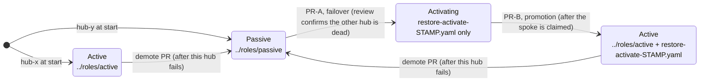

# Git-driven DR roles (the automated paths)

How the two git-driven failover paths work: each hub's DR role lives in
git, and a failover is two pull requests. The operator procedure is the
[Automated Pull Path runbook](../docs/runbooks/dr-failover-pull-gitops/README.md);
what the live runs measured is in [docs/results.md](../docs/results.md).

## Layout

| Path | What it is |
| --- | --- |
| `roles/active/` | The active role: the `BackupSchedule` (same spec as `manifests/55-backupschedule.yaml`) |
| `roles/passive/` | The passive role: the continuous sync `Restore` (same spec as `manifests/56-restore-passive.yaml`) |
| `hub-x/`, `hub-y/` | One overlay per hub. Its `resources` list *is* that hub's current role |
| `templates/restore-activate.template.yaml` | The activation one-shot, copied into an overlay during failover |
| `bootstrap/` | The per-hub `dr-role` Application and the RBAC it needs, applied once by hand |

The repo starts with hub-x active and hub-y passive. CI
(`hack/validate.py`) keeps the `manifests/` and `dr/` copies identical,
checks that each overlay renders a legal role, and prints the posture.

## Mechanism

Each hub's DR role (active = BackupSchedule, passive = sync Restore) is
git state under `dr/<hub>/`, reconciled by **that hub's own local Argo
CD**, bootstrapped once, imperatively, per hub
(`bootstrap/dr-role-<hub>.yaml`). The reconciler survives the *other*
hub's death by construction, which is the property that makes git-driven
failover possible at all: after a disaster, the surviving hub is both the
decision's subject and its executor.

An overlay moves through these states; each arrow after the start is
one merged pull request:

**Failover = TWO pull requests** (activation, then promotion; the
one-PR version is falsified, see below):

1. **PR-A (activation).** Branch. In `dr/<survivor>/kustomization.yaml`,
   set `resources` to ONLY the activation one-shot: copy
   `templates/restore-activate.template.yaml` to
   `dr/<survivor>/restore-activate-<UTCSTAMP>.yaml` (unique name; the
   template header says why) and make it the sole resources entry,
   dropping `../roles/passive` and NOT adding `../roles/active`.
2. Open PR-A. **The PR review IS the split-brain guard**: the reviewer
   (or a CI check) must verify the old active hub's API is actually dead,
   the same gate as the manual path's step B.1, moved into the merge
   decision.
3. Merge PR-A. The survivor's local Argo syncs (3-minute poll, or annotate
   `dr-role` with `argocd.argoproj.io/refresh=normal` to cut the wait),
   prunes the passive Restore first (`PruneFirst=true`), and applies the
   activation one-shot. If the operator evaluated the one-shot before the
   prune completed, it is ignored; the runbook's step D'.3 recovery
   (delete it, selfHeal re-creates it) takes about 30 seconds. Then the
   machinery from the manual path takes over: restore `Finished`, MSA
   auto-import, re-home.
4. **PR-B (promotion), only after the claim is verified** (managed
   clusters `Joined/Available` on the survivor): add `../roles/active`
   back above the activation file in the overlay. Its merge delivers the
   BackupSchedule, the git-driven equivalent of manual step F.1, and like
   it, deliberately AFTER activation.
5. Post-activation hygiene (the [MSA token
   cleanup](../docs/msa-token-hygiene.md): delete the restored
   `auto-import-account` secrets once clusters are imported) stays a
   gated imperative step; see "Imperative residue" below.

**Why two PRs (falsified live).** A single PR that flips straight to
`../roles/active` delivers the BackupSchedule and the activation Restore
in the SAME sync, and two failure modes follow. (1) The backup operator
**ignores a Restore while any BackupSchedule is active** ("This resource
is ignored because BackupSchedule resource schedule-acm is currently
active"), so the activation is refused, and because a Restore is
one-shot, re-applying the identical spec later is a silent no-op. (2)
Worse, the premature schedule immediately fires a full backup set from
the not-yet-active survivor, writing its **passive (empty-fleet) state
over the bucket's `latest`**, after which even a correctly re-run
activation restore "succeeds" while restoring nothing. Both happened in
one run; the split is load-bearing, not style.

**Failback/demote = the mirror PR** (it can be merged while the dead hub
is still down): flip the dead hub's overlay to `../roles/passive` and
delete any `restore-activate-*.yaml` file from it. When the hub boots, its
local Argo syncs current truth directly: it prunes its stale
BackupSchedule (automating the manual step G.2) and applies the passive
restore (G.4). The `BackupCollision` guard remains as defense in depth
underneath; in the live runs the prune and the collision freeze each came
first once, and both orders were benign.

## Imperative residue (deliberate, documented)

Pretending everything is declarative is how operators get burned. These
stay imperative, with their safety gates:

- **Bootstrap** (`bootstrap/`): once per hub, by hand, RBAC FIRST
  (`dr-role-rbac.yaml`, then `dr-role-<hub>.yaml`). The default
  openshift-gitops controller cannot touch the ACM backup CRs, and the
  operator's `managed-by` label trick does NOT fix it (its minted role is
  an API-group allowlist that omits `cluster.open-cluster-management.io`;
  checked with `oc auth can-i`). The explicit two-resource Role is both
  the fix and the tighter statement of what git-driven DR may touch. A
  sync that exhausted its retries while RBAC was missing stays `Failed`:
  Argo does not retry the same revision on its own. Trigger a fresh
  operation after fixing permissions:
  `oc patch applications.argoproj.io dr-role -n openshift-gitops --type merge -p '{"operation":{"sync":{}}}'`.
- **Stale ManagedCluster deletion on a returned hub** (manual step G.3):
  runtime state, not git state, and it carries the exercise's one
  dangerous gate: `Available: Unknown` first, *never* elapsed time ("if
  the status is not Unknown, your workloads are uninstalled").
- **Post-activation MSA secret cleanup** ([MSA token
  hygiene](../docs/msa-token-hygiene.md)): conditional on an observed
  `TokenReported` that is `False` or missing; scriptable, not declarable.

## Coexistence with manual operation

Once this wiring is live, **manual role surgery on a hub is fought by its
reconciler**: selfHeal re-created a manually deleted passive Restore in
**6 seconds**. Consequences:

- The manual paths REQUIRE the break-glass suspend first (Manual Pull
  Path runbook step D.0): null out `syncPolicy.automated` on the operated
  hub's `dr-role`, operate, re-align git to the new reality, and only then
  re-enable automation.
- A hand-applied activation restore is not tracked by Argo, so a later
  demote PR does not prune it; delete it by hand (manual step G.5).
- This is the customer lesson in miniature: git-driven and imperative
  operation do not compose on the same resources. Pick one as
  authoritative and make the other an explicit, documented exception.

## Why each hub's dr-role Application must never be backed up

ACM's resource backups include argoproj objects in `openshift-gitops`
(the ApplicationSets restore cross-hub, in both directions). A `dr-role`
Application restored onto the other hub would make that hub reconcile the
WRONG role directory: split-brain delivered by the backup system itself.
Hence the non-negotiable `velero.io/exclude-from-backup: "true"` label on
both bootstrap Applications, which CI enforces. A backup's instance list
confirms it (Automated Pull Path runbook step P.2): the demo Applications
and ApplicationSets are in it, `dr-role` is not.
